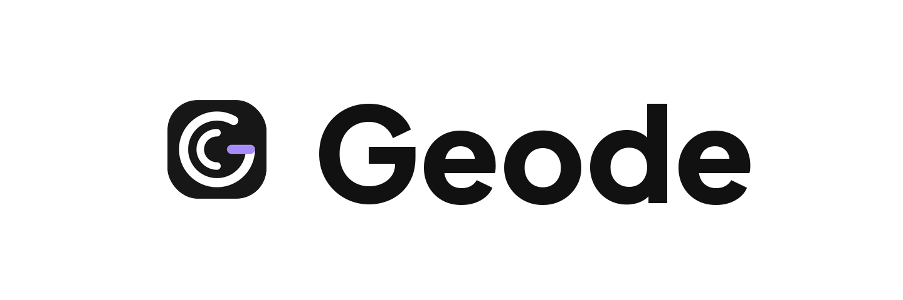
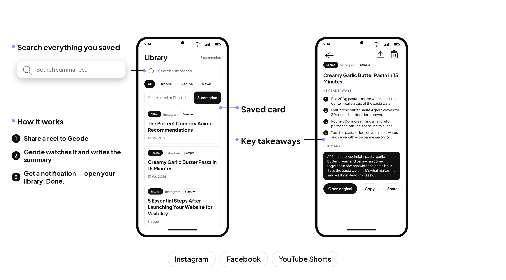
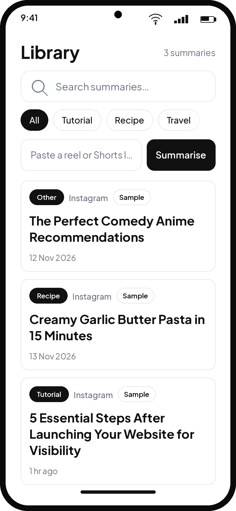
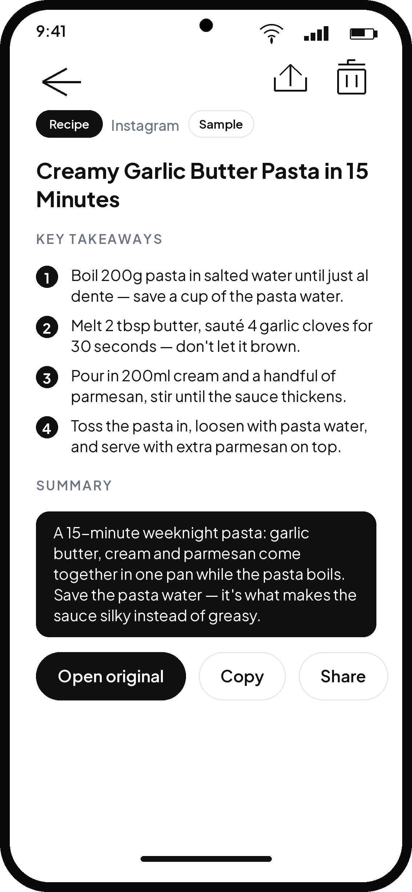

<p align="center">
  <picture>
    <source media="(prefers-color-scheme: dark)" srcset="assets/banner-white.png">
    
  </picture>
</p>

<p align="center"><strong>Your alt account is not a save folder.</strong></p>

<p align="center">Tired of sending reels to your alt account and forgetting them by the next day? Meet Geode — share any reel and get back a clean, searchable summary in seconds. The idea stays. The scroll doesn't.</p>

<p align="center">
  <a href="https://github.com/JSxtrme/Geode/releases"></a>
  
  <a href="LICENSE"></a>
  
  
</p>



## Why Geode exists

You watch hundreds of reels a week — a recipe you'll never cook, a tutorial you'll never rewatch, a place you'll never visit. Not because they weren't good. Because sending them to an alt account is where ideas go to die.

Geode fixes the last step. Share a reel from Instagram, Facebook, or YouTube Shorts, and Geode breaks it down into key takeaways and a short summary — the kind you'd actually read later. Then it files it away in a library you can search like notes, not scroll like a feed.

**Save the reel. Keep the idea.**

## Screenshots

<p align="center">
  
  
</p>

<p align="center"><em>Library and detail views (renders). The recipe card is a stand-in made for this README — the app's own seeded samples are the anime, JEE and website cards.</em></p>

## Features

- **Share it. Get the point.** One tap from the share sheet, and a reel becomes key takeaways and a summary. No copy-pasting links, no rewatching.
- **Your key, your rules.** Geode is BYOK — bring your own free Gemini key. It lives encrypted on your phone and talks only to Google. No account, no server, no one else's hands on your data.
- **Private by design.** Summaries are stored on your device, not ours. There is no ours — Geode has no server.
- **Find it later, in seconds.** Search every summary you've ever saved. That recipe from three weeks ago is one search away.
- **Hindi in, English out.** A reel in Hindi still comes back as a clean English summary.
- **Light as it gets.** About 1.7 MB to download, around 7 MB installed. Your phone won't even notice it.

## How it works

1. Share a reel to Geode.
2. Geode watches it and writes the summary.
3. Get a notification. Open your library. Done.

## Download

Grab the latest APK from the [Releases](https://github.com/JSxtrme/Geode/releases) tab and install it on your phone. Every release is signed with the same key, so updates install over the previous version — no uninstall needed.

Geode is in beta — expect rough edges, and please report bugs on GitHub.

## Get your free API key

Geode runs on your own Gemini API key. It's free, takes about two minutes, and needs no card or billing — the free tier is enough for reels.

1. Tap **Open AI Studio** in the app — it opens in your browser.
2. If it asks you to sign in, choose your Google account (or **Use another account**).
3. Accept the terms if asked — Google makes a free project and key for you.
4. On the API Keys page, find the key called **Default Gemini API Key** and tap the copy icon next to it.
5. Come back to Geode and paste it below.

The key is tested the moment you paste it, and it's stored encrypted on your phone. You can change or remove it anytime in Settings.

## Privacy

- **Bring your own key.** Your Gemini key is stored encrypted on your device and sent only to Google's API. It is never baked into the app, never uploaded anywhere, and never shared.
- **No account, no tracking.** Geode has no sign-up, no analytics, no ads, and no server of its own. Your summaries live in a database on your phone.
- **No Instagram login, ever.** Geode never asks for your Instagram, Facebook, or Google credentials. It reads public reels only — a private reel just gets a short notice saying Geode couldn't see it.
- **Failed shares leave no trace.** If a reel can't be summarised, nothing is saved to your library. You only get a notification.

## Build from source

Requirements: JDK 17, Android SDK (API 36), Gradle 8.11.1.

```sh
# Debug build (no signing needed)
~/gradle-8.11.1/bin/gradle assembleDebug --no-daemon --offline
```

The verified release path uses the Gradle distribution directly (the wrapper is included, but the direct invocation is what the release builds use):

```sh
export JAVA_HOME=~/jdk17
export GRADLE_USER_HOME=~/gradle-home
export ANDROID_HOME=~/android-sdk
export JAVA_TOOL_OPTIONS=-Djava.net.preferIPv4Stack=true
~/gradle-8.11.1/bin/gradle assembleRelease --no-daemon --offline
```

The release APK is unsigned out of Gradle — zipalign and sign it with `apksigner` afterwards. Release signing needs the maintainer's keystore, which is **not** in this repository.

---

## Disclaimer

Geode is an independent personal project. It is not affiliated with, sponsored by, or endorsed by Instagram, Facebook, Meta, YouTube, or Google (including Gemini). Those names and trademarks belong to their owners.

Geode only processes links you choose to share with it. It never asks for your Instagram, Facebook, or Google login, and it only reads public reels. Please respect the platforms' terms of service and the rights of the creators whose content you save.

The software is provided "as is", without warranty of any kind (see the MIT license). AI-generated summaries can be wrong, so check anything important yourself. You are responsible for your own Gemini API key, its usage and any charges, and for following Google's API terms. The author is not liable for how summaries are used.

This is a good-faith statement, not legal advice.

Geode is a personal project by [JSxtrme](https://github.com/JSxtrme). Reels, Instagram, Facebook, YouTube, and Gemini are trademarks of their respective owners.
